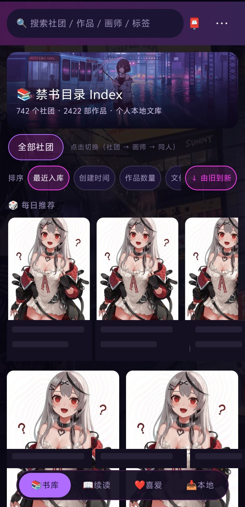

# Index — ローカル漫画ライブラリ管理パネル

[中文](README.md) · [English](README.en.md) · [**日本語**](README.ja.md)

<p align="center">
  
  
</p>

**サークル**単位で閲覧し、**タグ**（イベント / 原作 / 絵師）を自動付与、タグを横断検索、
受信箱で内容を確認してから取り込み、読書進捗は端末間で同期。Android 用リーダーも同梱。
すべてローカルで動作します（Flask API + 素の HTML/JS、クラウドサービス不要）。

> **個人のローカル利用を想定しています。** 本プロジェクトは著作物を提供・保管・配布せず、
> サイトの認証情報も同梱しません。ご利用の地域の法令および各サイトの利用規約は
> 利用者ご自身の責任で遵守してください。
>
> スクリーンショットの表紙と作品情報はすべてプレースホルダーです。

## 機能

- **ライブラリスキャン** — `<サークル>/<作品>.zip|cbz|rar|cbr` または
  `<サークル>/<作品名>/画像…` を読み取り、`(C100) [サークル (絵師)] タイトル (原作) [翻訳]`
  という一般的な命名規則を解析します。判別できない項目は削除せず「保留」フォルダにまとめます
- **メタデータ層** — `meta.db`（SQLite）が唯一の情報源。タグ、読書進捗、評価、別名、
  お気に入り絵師をここで管理します（ファイル名からの推測ではありません）
- **受信箱** — ダウンロード物はまず `_inbox/` に入り、確認後に sha1 で重複排除・改名・
  サークルへの振り分けが行われます
- **閲覧** — Web リーダー + Android アプリ（オフラインパッケージ、進捗の双方向同期、
  QR コードによるペアリング、画質 3 モード）
- **外部ダウンローダー** — コマンドテンプレートで任意の CLI ダウンローダー（gallery-dl など）を
  接続。成果物は zip にまとめて受信箱へ
- **セーフカバーモード** — ドロワーのスイッチひとつで全表紙をプレースホルダーに置換。
  スクリーンショットや画面録画でライブラリの中身が漏れません

## 動作環境

| | |
|---|---|
| OS | Windows 10 / 11（主対象。ランチャー・プロセス管理・LAN ペアリングは Windows 固有の実装で、Linux / macOS は未検証） |
| Python | 3.10 以上（CI は 3.12 / 3.13） |
| 任意 | [UnRAR](https://www.rarlab.com/rar_add.htm) または WinRAR —— `.rar` / `.cbr` を読む場合のみ必要。`unrar.exe` を `PATH` に追加してください。未導入でも他の形式は問題なく動作します（rar 形式は表紙とページ一覧が使えません） |

## クイックスタート

```bat
pip install -r requirements.txt
copy config.example.json config.json
python app.py            :: 既定では http://127.0.0.1:8765
```

プログラムとライブラリは**別ディレクトリ**に置きます。プログラムはライブラリルートの
`_app/` サブディレクトリに配置し、ライブラリルートは既定でその親ディレクトリになります
（Web UI の「設定」で変更可能）。

```
D:\my-library\          <- ライブラリルート
├── サークルA (絵師)\
│   ├── (C100) [サークルA (絵師)] タイトル (原作).zip
│   └── 作品フォルダ\画像…
└── _app\               <- 本プログラム
    ├── app.py
    ├── config.json     <- ローカル設定（トークン / ライブラリパス）。.gitignore 済み、コミットしないこと
    ├── meta.db         <- メタデータ（削除しないこと）
    ├── _inbox\         <- 確認待ちの作品
    └── _cache\ _logs\ _state\   <- 実行時生成物。削除しても再生成されます
```

## 外部ダウンローダー

特定サイトに縛られません。普段使っているダウンローダーをコマンドテンプレートで接続します。
`config.json`:

```json
"ext_downloaders": [
  { "name": "gallery-dl", "cmd": "gallery-dl -d \"{dest}\" {url}", "timeout": 1800 }
]
```

Web UI の「リストダウンローダー」→「外部ダウンローダー」で、1 行 1 URL を貼り付けます
（そのまま `{url}` として渡されます）。`{dest}` は実行ごとの一時ディレクトリです。
成果物は zip にまとめられて受信箱に入り、確認後に取り込まれます。

## 同梱のサイトアダプタ

本リポジトリに同梱されるアダプタは **JM 直結**（`crawlers/crawl_jm_direct.py`）のみです。
公開ライブラリ [jmcomic](https://github.com/hect0x7/JMComic-Crawler-Python)
（`pip install jmcomic`）を利用します。その他のアダプタは配布されません。
パネルは実際に利用可能なタスクに合わせて UI を自動的に絞り込みます。

## 開発

- 開発規約と定量的な予算: [`docs/engineering-discipline.md`](docs/engineering-discipline.md)
  —— ファイル行数・関数行数・循環的複雑度は `scripts/quality_gate.py` とテストによって
  **機械的に判定**されます
- 構造マップ: [`docs/architecture.md`](docs/architecture.md)
- リリース履歴: [`CHANGELOG.md`](CHANGELOG.md)

```bat
pip install -r requirements.txt -r requirements-dev.txt
python scripts/quality_gate.py     :: 開発規約ゲート
python -m pytest tests/ -q         :: 回帰テスト
python -m ruff check .             :: 静的チェック（補助）
git config core.hooksPath .githooks  :: 任意: コミット前にゲートを実行
```

## 既知の制限

- **シングルユーザー**設計：アカウント機能はなく、トークンはリモートアクセスの入口制御のみ
  （ループバックは除外）
- スマートフォンは同一 LAN か、同一のオーバーレイネットワーク（Tailscale / ZeroTier など）に
  参加している必要があります
- 大きなライブラリの初回スキャンは時間がかかります。サムネイルは必要時に生成されます
- `meta.db` が唯一の情報源です。アップグレード前にバックアップを取ってください

## セキュリティ

脆弱性は公開 issue ではなく [`SECURITY.md`](SECURITY.md) の手順で非公開に報告してください。
同ファイルに脅威モデル（トークンゲート / LAN 公開 / QR ペアリング / パストラバーサル /
外部ダウンローダー）を記載しています。

## ライセンス

[GPL-3.0](LICENSE) · Copyright (C) 2026 Index contributors
